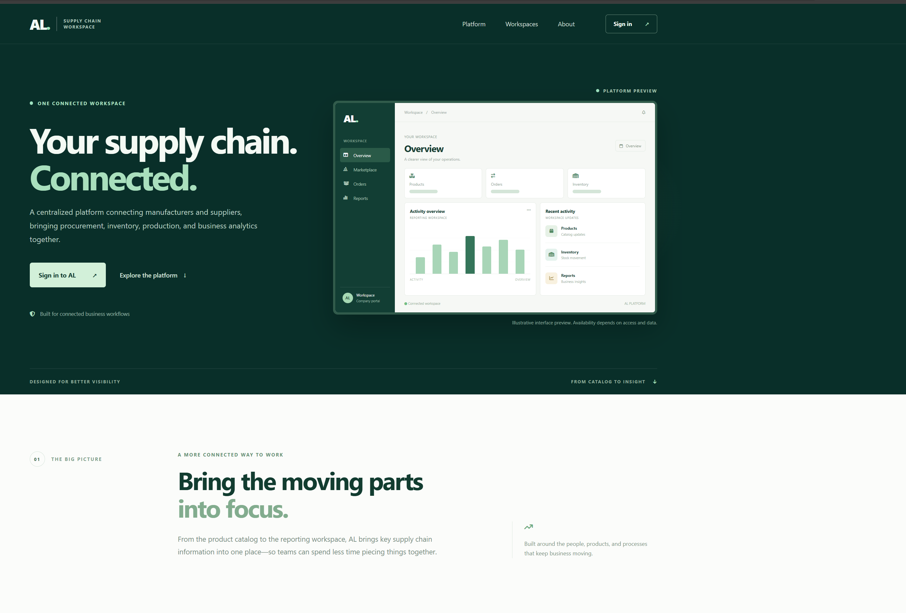
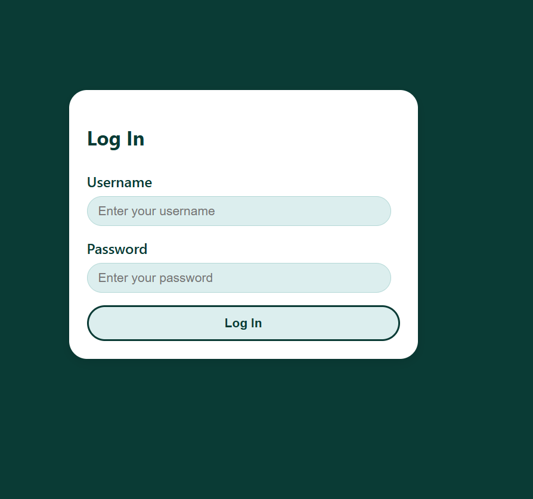
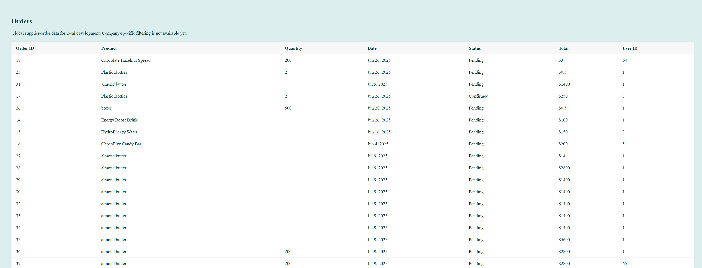

# AL — Supply Chain Workspace


AL is a full-stack B2B supply-chain portfolio prototype that connects a shared product marketplace with company and supplier workspaces. It demonstrates Angular and TypeScript frontend development, Node.js and Express REST APIs, Oracle data integration, and authenticated, permission-aware access to operational information.

The application is designed for local demonstration using fictional data. Its operational views are read-only and available according to the user's access and development configuration.

## Highlights

- **Company workspace:** dashboard statistics and recent activity, searchable marketplace, order records, and reports.
- **Supplier workspace:** a dedicated dashboard, shared marketplace, and catalog insights.
- **Data visualization:** eight interactive Chart.js visualizations across the company reports and supplier catalog, with tables and loading, empty, and error states.
- **Security:** username-based login with bcrypt verification and JWT sessions, organization-aware Angular route guards, and backend authorization checks.
- **Engineering:** typed Angular services, an HTTP interceptor that sends credentials only to the trusted backend, parameterized Oracle queries, and frontend and backend automated tests.

## Architecture

```text
Angular / TypeScript
  Components · services · route guards · HTTP interceptor
                    |
              REST API requests
                    |
Node.js / Express
  Authentication · authorization · routes · controllers
                    |
              node-oracledb
                    |
          Oracle Database 19c
```

The documented Oracle schema contains **15 tables**, covering companies, users and roles, products and images, warehouses, inventory movements, supplier orders, payments, invoices, production, recipes, and stock adjustments. Supplier organizations are represented by company records. See [AL_DATABASE_SCHEMA.md](AL_DATABASE_SCHEMA.md) for the schema reference.

## Reports and analytics

Seven company-report charts visualize warehouse capacity, order status and trends, inventory movement quantities and history, and recorded payments by method and status. A supplier catalog chart provides an eighth visualization. Operational reports use global data for authorized local development; they do not represent company-specific filtering or revenue.

## Authentication and access

- Login creates a short-lived signed JWT in an HttpOnly, SameSite cookie. The token is not returned in the JSON response.
- bcrypt password hashes and existing legacy plain-text passwords are currently supported. Public signup is disabled.
- Angular guards manage session restoration and portal navigation. Express independently verifies the session, current organization association, and applicable permissions.
- Marketplace reads require an eligible role and verified organization. Global operational reads require an explicitly approved local-development user; this allowlist is inactive in production.
- Logout clears the cookie, but a copied stateless JWT remains valid until it expires.

See [AL_PERMISSIONS.md](AL_PERMISSIONS.md) and [AL_RESOURCE_ACCESS.md](AL_RESOURCE_ACCESS.md) for permission and ownership details.

## Local setup

**Prerequisites:** Node.js, npm, a running Oracle Database, and an existing compatible schema and user account. The repository documents the schema but does not include a database export, seed data, or a complete schema installation script. Public registration is unavailable, and no demo credentials are included.

Copy `al-backend/.env.example` to `al-backend/.env`, then supply your own values:

```dotenv
ORACLE_DB_USER=YOUR_ORACLE_USER
ORACLE_DB_PASSWORD=YOUR_ORACLE_PASSWORD
ORACLE_CONNECT_STRING=YOUR_ORACLE_CONNECT_STRING
JWT_SECRET=YOUR_RANDOM_SECRET_AT_LEAST_32_CHARACTERS
DEV_ADMIN_USER_IDS=
```

Generate a cryptographically random JWT secret of at least 32 characters and keep `.env` private. `DEV_ADMIN_USER_IDS` optionally lists explicitly approved user IDs for global operational reads in local development; leave it empty to deny that access.

Start the backend:

```sh
cd al-backend
npm install
node server.js
```

In a separate terminal, start the frontend:

```sh
cd al-frontend/al-frontend-app
npm install
npm start
```

Open [http://localhost:4200](http://localhost:4200) and sign in using an existing local Oracle account. The backend listens on port 3000.

## Tests and build

```sh
# Backend tests, from al-backend
npm test

# Frontend tests, from al-frontend/al-frontend-app
npm test -- --watch=false --browsers=ChromeHeadless

# Frontend production build, from al-frontend/al-frontend-app
npm run build
```

## Screenshots

### Landing page



### Sign in



### Orders



### Supplier orders report


### Payments report


## Future improvements

- Complete purchasing, registration, and full CRUD; business mutations are currently disabled.
- Establish verified ownership relationships and company-specific operational filtering, including supplier-order ownership and marketplace publication rules.
- Migrate legacy plain-text passwords to bcrypt and complete production security and authorization hardening.

AL is a local portfolio prototype, not a production-ready multi-tenant system. A separate security and data-ownership review is required before production use.